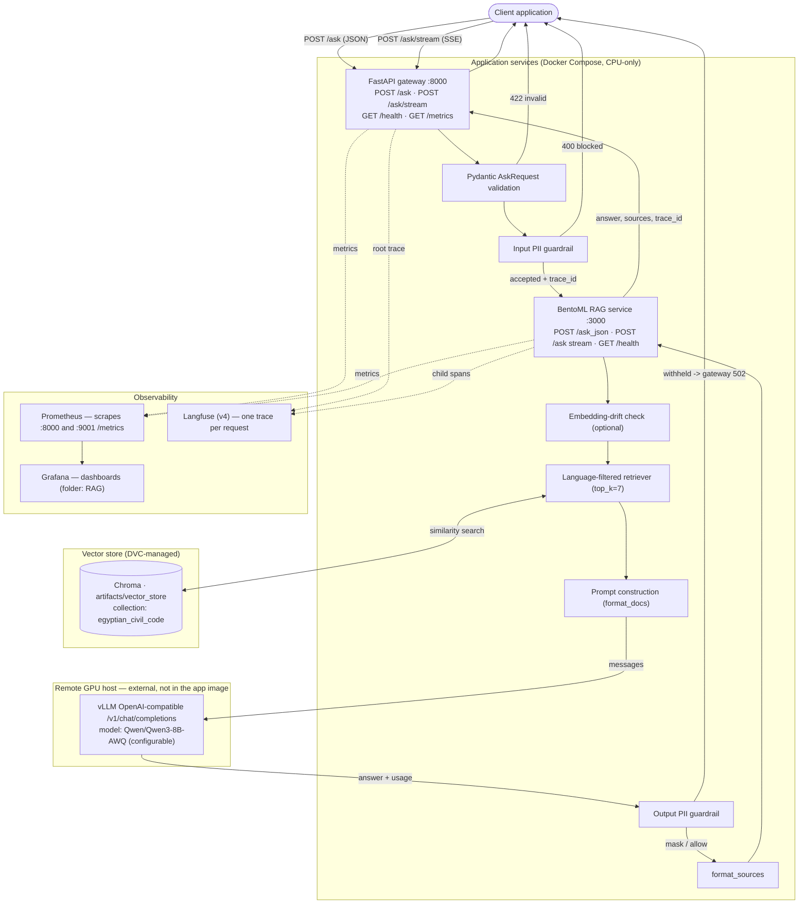
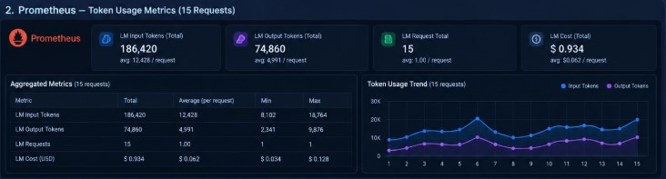
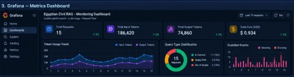
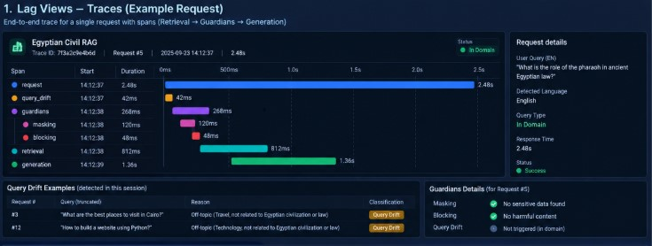

# Egyptian Civil RAG

A **Retrieval-Augmented Generation (RAG)** system that answers questions about the
**Egyptian Civil Code**. A user submits a natural-language question (Arabic or English); the
system retrieves the most relevant articles of the law from a vector store, grounds an LLM in
those retrieved passages, and returns a source-cited answer.

It is built as **two small services plus an external model server and an observability stack**:

- a **FastAPI gateway** (`rag_project.api.app`) that only validates input, applies an input PII
  guardrail, and forwards to the RAG service, and
- a **BentoML service** (`service.bentoml_service.RAGService`) that owns the whole RAG pipeline —
  embedding, **Chroma** retrieval (BGE-M3), prompt construction, and generation against a
  **remote vLLM** GPU server through an OpenAI-compatible API.

Answers are traced with **Langfuse**, measured with **Prometheus**, visualized with **Grafana**,
and can be scored for faithfulness with **RAGAS**. Data and the vector index are versioned with
**DVC**, and everything but the GPU server runs under **Docker Compose**.

> **Scope note.** This system grounds answers in retrieved legal text, but it is **not** a
> substitute for a qualified legal professional. Retrieval reduces (it does not eliminate)
> hallucination, and no output is a legal opinion or advice.

---

## Table of Contents

1. [Project Overview](#1-project-overview)
2. [Features](#2-features)
3. [Architecture](#3-architecture)
4. [Request Lifecycle](#4-request-lifecycle)
5. [Technology Stack](#5-technology-stack)
6. [Project Structure](#6-project-structure)
7. [Prerequisites](#7-prerequisites)
8. [Installation](#8-installation)
9. [Configuration](#9-configuration)
10. [Running the Application](#10-running-the-application)
11. [API Documentation](#11-api-documentation)
12. [Testing](#12-testing)
13. [Monitoring and Observability](#13-monitoring-and-observability)
14. [Security](#14-security)
15. [Known Limitations](#15-known-limitations)
16. [Troubleshooting](#16-troubleshooting)

---

## 1. Project Overview

### The problem

Legal research over a statutory code such as the Egyptian Civil Code (≈1,149 articles) is
time-consuming: a practitioner must locate the right article(s), read them, and reason about how
they apply. A general-purpose LLM already "knows" a lot of text but cannot cite the exact,
current article and frequently invents numbers or wording. That is dangerous in a legal context.

### Why retrieval, then generation

**Retrieval** answers "which articles are relevant?" by embedding the question and searching a
vector store of the law's articles. **Generation** then takes those retrieved passages as
*context* and the question, and produces an answer that only uses the context (the system prompt
forbids inventing facts and instructs the model to quote article text when asked). Splitting the
task gives two benefits:

- **Grounding / citations.** The answer is tied to real articles, and the response returns the
  source article numbers (see `format_sources`), so a reader can verify it.
- **Freshness without retraining.** Update the index, not the model.

Retrieval grounds the answer, but it does **not** guarantee correctness or remove
hallucination: retrieval can miss the right article, and the model can still misread the context.
Faithfulness and answer relevance are therefore measured directly (RAGAS) rather than assumed.

### How the pieces fit

- **FastAPI gateway** — the public HTTP surface (port 8000). It validates the request with
  Pydantic, runs the **input PII guardrail**, mints a **trace id**, and forwards the question to
  the BentoML service. It does **no** retrieval or generation.
- **BentoML RAG service** — the inference owner (port 3000). It loads the embedding model and the
  Chroma collection **once at startup**, then per request runs optional **embedding-drift**
  scoring, **retrieval**, **prompt construction**, **generation** via the remote vLLM server, an
  **output PII guardrail**, and **source formatting**.
- **Chroma** — the vector store (`artifacts/vector_store`, collection `egyptian_civil_code`),
  searched with **BGE-M3** embeddings and a **language filter** so Arabic questions retrieve
  Arabic chunks and English questions retrieve English chunks.
- **Remote vLLM** — a GPU server (outside the application image) exposing an OpenAI-compatible
  `/v1/chat/completions` endpoint. The app is CPU-only and treats this endpoint as an external
  dependency.
- **Observability** — Langfuse (per-request traces + spans + scores), Prometheus (metrics scraped
  from the gateway and the service), Grafana (dashboards), plus optional RAGAS faithfulness.

### Boundaries

The system is a **question-answering assistant over the civil code**, not a legal engine: it has
no authentication, does not reason about jurisdictions or amendments beyond what is indexed, and
its coverage is limited to the documents that were ingested.

---

## 2. Features

All items below are implemented in the current source and configuration.

| Feature | Where it lives | Notes |
|---|---|---|
| Arabic/English civil-law Q&A | `service/bentoml_service.py`, `src/rag_project/generation/prompts.py` | Answer follows the question's language (prompt rule 12). |
| Legal-document ingestion / indexing | `scripts/build_index.py`, `scripts/extract_data.py`, `src/rag_project/ingestion/*` | PDF → articles → chunks → embeddings → Chroma. |
| Incremental re-indexing | `scripts/reindex.py` | Adds a document's chunks to the **existing** collection with `newdoc_*` ids; no rebuild. |
| Chroma vector search | `src/rag_project/indexing/vector_store.py`, `retrieval/retriever.py` | Similarity search, `top_k = 7`. |
| Language-aware retrieval | `retrieval/retriever.py` (`LanguageFilterRetriever`, `detect_language`) | Drops chunks whose language differs from the question. |
| Remote vLLM inference | `service/llm_client.py` | OpenAI-compatible client; non-streaming and streaming. |
| SSE streaming endpoint | `src/rag_project/api/app.py` (`POST /ask/stream`) | Real progressive token streaming through the public gateway. |
| Input & output PII guardrails | `guardrails/pii_detector.py`, `api/app.py`, `service/bentoml_service.py` | Detect → mask/block; national-id → block on input, mask on output by default. |
| Embedding-drift monitoring | `monitoring/evaluate_embedding_drift.py`, `service/bentoml_service.py` | Max cosine similarity vs a 50-question baseline; threshold `0.45` (provisional). |
| Request trace-id propagation | `observability/langfuse_tracing.py`, `api/app.py`, `bentoml_service.py` | One trace per request across gateway + service. |
| Token usage tracking | `service/llm_client.py`, `monitoring/metrics.py` | Exact usage from vLLM metadata; clearly-labelled estimates otherwise. |
| Prometheus metrics | `monitoring/metrics.py`, `/metrics` on both services | See [Monitoring](#13-monitoring-and-observability). |
| Grafana dashboards | `monitoring/deployment/grafana/*` | Provisioned data source + `rag_overview.json`. |
| Langfuse tracing | `observability/langfuse_tracing.py` | Spans + faithfulness score attached to the trace. |
| Optional online RAGAS faithfulness | `src/rag_project/evaluation/faithfulness.py` | Per-request judge; **disabled by default** (`ONLINE_EVAL_ENABLED=0`). |
| Automated tests | `tests/` | Offline unit tests; see [Testing](#12-testing). |
| DVC-managed data | `dvc.yaml`, `.dvc/config`, `*.dvc` | Articles PDF and the vector index live in the DVC remote. |
| Docker deployment | `Dockerfile`, `docker-compose.yml` | Gateway + BentoML + Prometheus + Grafana (CPU-only; vLLM is remote). |

Notes on what is **not** claimed:

- The JSON `POST /ask` returns the complete answer at once; it is **not** streaming. Streaming is
  only on `POST /ask/stream`.
- Online RAGAS evaluation is **off** by default and adds latency + judge (LLM) cost when enabled.
- There is no authentication/authorization layer (see [Security](#14-security) and
  [Known Limitations](#15-known-limitations)).

---

## 3. Architecture

### Component diagram



### Reading the diagram

- **Application services.** The gateway and the BentoML service are two separate processes. The
  gateway is stateless HTTP plumbing; the BentoML service owns the RAG pipeline, the embedding
  model, and the Chroma connection. They talk over HTTP: the JSON path calls
  `POST /ask_json`, the streaming path calls `POST /ask`.
- **Pydantic validation** rejects malformed bodies (`422`) before anything is forwarded.
- **Input guardrail** decides `allow` / `mask` / `block`. A **blocked** request returns `400`
  and is **never forwarded** to BentoML; a **masked** request has detected PII redacted first.
- **Drift check** is an optional *signal* (never a gate): a detector failure is recorded but does
  not fail the request.
- **Chroma** is the single source of retrieved passages; it lives outside the code, is mounted
  read-only into the service, and is versioned by DVC.
- **Remote vLLM** sits **outside the container boundary** on a GPU host. The application image
  contains no model weights and no CUDA; generation is a network call to `VLLM_BASE_URL`.
- **Output guardrail** masks or (if configured) withholds the answer; a withheld answer surfaces
  to the client as a generic `502` from the gateway.
- **Observability is orthogonal.** Prometheus scrapes both `/metrics` endpoints (gateway on
  `:8000`, service on `:9001`); Grafana reads Prometheus; Langfuse receives the traces. Metrics
  (numeric time series) and traces (per-request spans) are different signals and are not the same
  thing.

Verified scrape targets (`monitoring/deployment/prometheus.compose.yml`): `fastapi-gateway:8000`
and `bentoml-service:9001` on the Compose network. The host-side variant
(`monitoring/deployment/prometheus.yml`) targets `host.docker.internal` because there the apps
run on the host.

---

## 4. Request Lifecycle

This traces one question through the JSON path (`POST /ask`) end to end, in order. The streaming
path (`POST /ask/stream`) follows the same validation and guardrails but calls BentoML `POST /ask`
and yields tokens; it is called out where it differs.

### Phase A — API entry and validation

1. **Client submits a question** to `POST /ask` with a JSON body
   `{ "question": "...", "langfuse_trace_id": "..." }` (`langfuse_trace_id` is optional).
2. **FastAPI receives the request** on `rag_project.api.app:ask`.
3. **Pydantic validation.** The body is validated against `AskRequest`: `question` is a required
   string of `min_length=1`; `langfuse_trace_id` is an optional string. A body that fails this
   (missing/empty `question`, wrong types) is rejected by FastAPI with **HTTP `422`** before any
   handler logic runs, and the request is never forwarded.
4. **Trace id.** The handler mints or continues a trace id:
   `trace_id = request.langfuse_trace_id or lf.new_trace_id()`. When Langfuse is disabled this
   falls back to a local `uuid4` used only for internal correlation.

### Phase B — Guardrail and forwarding

5. **Input PII guardrail** (when `GUARDRAIL_ENABLED` is on): the question is scanned with
   `pii_detector.detect(question)` and `pii_detector.decide(scan)`. Default policy:
   `egyptian_national_id → block`, `egyptian_mobile → mask`, `email → mask`; the strongest action
   wins.
   - **Block** → the gateway records the metric and raises `HTTPException(400, "The request was
     blocked by the input guardrail.")`. The question is **not** forwarded to BentoML.
   - **Mask** → the question text is redacted in place, then forwarded.
6. **Forwarding.** The gateway POSTs `{ "question": <maybe-masked>, "langfuse_trace_id": trace_id }`
   to `BENTOML_BASE_URL + /ask_json` using `requests` with `timeout = BENTOML_TIMEOUT`.

### Phase C — BentoML processing (retrieval and context)

7. **BentoML receives `/ask_json`** (`question`, `langfuse_trace_id`) and re-validates: an empty
   question, or a missing vLLM model, raises a client-safe `_RequestRejected`.
8. **Embedding-drift check** (when `DRIFT_ENABLED` and a baseline is present): the query is
   embedded with the **same** BGE-M3 function the retriever uses, and its max cosine similarity
   against 50 reference embeddings is computed. A similarity below the threshold records a
   *potential drift* signal; a detector **failure** is counted separately
   (`rag_embedding_drift_errors_total`) and written to the drift report with `status="error"`.
   Drift never blocks or fails the request.
9. **Retrieval.** `self.retriever.invoke(question)` embeds the question and runs a Chroma
   **similarity** search for `top_k = 7` chunks. The `LanguageFilterRetriever` then detects the
   question language (Arabic script / Latin letters) and **drops any chunk whose language
   differs**, preserving retrieval order for the survivors.
10. **Chunk → context.** `format_docs(documents)` joins survivors into one context block,
    prefixing each chunk with its article number from metadata:
    `Article 51:\n<page_content>`. Because `article_number` lives only in metadata, this prefix is
    what lets the model both quote and cite the article. Chunks without an article number are
    passed through verbatim. The Langfuse `retrieval` span stores only the **document count**
    (never the raw text) and the question is masked before it is ever sent to tracing.

### Phase D — Remote generation

11. **Prompt construction.** `self.prompt.ainvoke({...})` renders the existing legal-domain
    `ChatPromptTemplate` with `{context}` and `{question}` into a `PromptValue`.
12. **vLLM request.** `service.llm_client.prompt_value_to_messages` converts the `PromptValue`
    into OpenAI-style messages, and `generate_from_prompt` calls the OpenAI-compatible endpoint
    at `VLLM_BASE_URL` with `model = VLLM_MODEL`, `max_tokens` from config, and
    `extra_body={"chat_template_kwargs": {"enable_thinking": False}}`. The client timeout comes
    from `configs/config.yaml` (`vllm.timeout_seconds`, default `300`).
13. **Remote inference.** The **external GPU server** runs the model and returns the generated
    text (and, for the JSON path, an OpenAI `usage` object).
14. **Token usage.** `_capture_usage` reads `prompt_tokens`/`completion_tokens` from the response
    `usage`. If the server sends usage, it is recorded as **exact**
    (`rag_input_tokens_total` / `rag_output_tokens_total`); if not, a clearly-labelled
    **estimate** (`chars // 4`) is recorded to the separate `rag_token_estimates_total`.
    Streamed chunks are never counted as tokens.

### Phase E — Output processing, evaluation, and delivery

15. **Output PII guardrail.** The answer is scanned. The default output policy **masks** all
    detected PII and continues (so the legal content survives while PII is redacted). With
    `GUARDRAIL_OUTPUT_BLOCK=1` a national ID **withholds** the whole answer. A withheld answer
    raises `_RequestRejected`.
16. **Sources.** `format_sources(documents)` returns the distinct article numbers of the retrieved
    chunks as citations (e.g. `["Article 51", "Article 119"]`) — real citations, never chunk ids.
17. **Optional RAGAS faithfulness.** Only when `ONLINE_EVAL_ENABLED=1`: the answer is judged
    against the retrieved contexts (`evaluate_faithfulness`) and the score is attached to this
    request's Langfuse trace with `create_score`. It runs in a worker thread and a **failure is
    recorded and swallowed** — an unavailable judge never fails the user's request.
18. **Response assembly.** BentoML returns
    `{ "answer", "sources", "langfuse_trace_id" [, "faithfulness" ] }` and flushes tracing.
19. **Gateway contract check.** FastAPI parses the upstream body: `answer` **must** be a string and
    `sources` a list; otherwise it is a malformed response (see below).
20. **Final response.** The gateway returns `AskResponse{ answer, sources, question,
    langfuse_trace_id }` to the client. (Note: the internal `faithfulness` field, when present, is
    attached to the trace but is **not** part of the public gateway response.)

### Streaming path differences

`POST /ask/stream` wraps each vLLM token chunk as a Server-Sent Event (`data: <chunk>\n\n`) and
ends with `data: [DONE]`. It applies the **same** validation and input guardrail (blocked → `400`)
and forwards to BentoML `POST /ask`, which yields tokens directly. The streaming path does **not**
run the output guardrail or RAGAS — those belong to the JSON `/ask_json` contract.

### Failure paths (verified status codes)

| Condition | Where | Result |
|---|---|---|
| Invalid/empty body, wrong types | FastAPI + Pydantic | **`422`** Unprocessable Entity (FastAPI default), not forwarded |
| Input guardrail blocks (e.g. national id) | Gateway input guardrail | **`400`**, question not forwarded |
| BentoML times out (`BENTOML_TIMEOUT`) | Gateway → `requests.exceptions.Timeout` | **`504`** "The RAG service timed out." |
| BentoML unreachable (connection) | Gateway → `requests.exceptions.ConnectionError` | **`503`** "The RAG service is unavailable." |
| Other request error, or upstream non-`200` | Gateway → `RequestException` / status check | **`502`** "The RAG service returned an error." |
| Malformed upstream body (`answer` not a string, etc.) | Gateway response parsing | **`502`** "…malformed response." |
| Output guardrail withholds the answer | BentoML raises → upstream non-`200` | **`502`** (generic message; reason is not exposed) |
| Remote vLLM down/timeout | BentoML → OpenAI client | BentoML raises → **`502`** to client |
| Drift detector error | BentoML `_evaluate_drift` | Recorded to `rag_embedding_drift_errors_total` + drift report; request **continues** |
| RAGAS evaluation error | BentoML `_evaluate_faithfulness` | Recorded to `rag_ragas_evaluations_total{status="failure"}`; request **continues** |

All client-facing messages are deliberately generic — no stack traces, keys, or internal details
are returned; details are logged server-side only.

---

## 5. Technology Stack

| Technology | Purpose | Implementation detail (verified) |
|---|---|---|
| Python | Runtime | `requires-python >= 3.11` (`pyproject.toml`); CI and the image use **3.12**. |
| FastAPI | Public HTTP gateway | `rag_project/api/app.py`; title "Egyptian Civil Code RAG Gateway"; auto OpenAPI at `/docs`. |
| Pydantic | Request/response models | `AskRequest`, `AskResponse`; `pydantic>=2.13`. |
| BentoML | RAG inference service | `service/bentoml_service.py` (`@bentoml.service`, `@bentoml.api`); `bentoml>=1.3` (extra `serving`). |
| OpenAI Python SDK | Remote vLLM client | `AsyncOpenAI` in `service/llm_client.py` (extra `serving`). |
| LangChain | Prompt + chaining plumbing | `ChatPromptTemplate` (`generation/prompts.py`), `format_docs`, LCEL composition. |
| Chroma | Vector store | `chromadb==1.5.9`, `langchain-chroma`; persists at `artifacts/vector_store`. |
| BGE-M3 embeddings | Question/document embeddings | `sentence-transformers`, `BAAI/bge-m3` (`embedding.embedding_model`). |
| vLLM | Remote GPU inference | OpenAI-compatible server; default model `Qwen/Qwen3-8B-AWQ`. |
| Prometheus | Metrics | `prometheus-client`; scraped from gateway `:8000/metrics` and service `:9001/metrics`. |
| Grafana | Dashboards | `grafana/grafana:11.1.0`; provisioned Prometheus data source + dashboards. |
| Langfuse | Tracing | `langfuse>=4.17,<5`; helpers in `observability/langfuse_tracing.py`. |
| RAGAS | Faithfulness evaluation | `ragas>=0.4.3`; real `Faithfulness` metric with the Gemini judge (`evaluation/faithfulness.py`). |
| Google GenAI (Gemini) | RAGAS judge / offline path | `generation.judge_model` (default `gemini/gemini-3.1-flash-lite`); key via `GEMINAI_API_KEY`. |
| DVC | Data/model versioning | `dvc[s3]` (extra `dvc`); remote `storj` (S3-compatible). |
| Docker / Compose | Packaging & deployment | `Dockerfile` (`python:3.12-slim`); `docker-compose.yml`. |
| pytest | Tests | `tests/`; `[tool.pytest.ini_options]` sets `testpaths=["tests"]`. |
| Ruff / pre-commit | Quality gates | `.pre-commit-config.yaml`; `.ruff_cache` referenced in ignore files. |

Versions above are taken from `pyproject.toml`, `*.lock`-style pins where present, and the Compose
files; nothing here is illustrative.

---

## 6. Project Structure

Generated, cached, and backup directories (`.venv/`, `__pycache__/`, `.pytest_cache/`,
`artifacts/*_backup_*`, `experiment_results/`, `mlruns/`, `logs/`, the DVC local cache `.dvc/cache`)
are excluded from this tree.

```text
Egyptian Civil RAG Project/
├── configs/
│   └── config.yaml               # Central configuration (chunking, embedding, retrieval,
│                                 #   vector_db, vllm, evaluation, drift, langfuse)
├── src/rag_project/
│   ├── api/app.py                # FastAPI gateway (validate, input guardrail, stream, forward)
│   ├── config/settings.py        # Loads config.yaml + .env; typed section getters
│   ├── generation/
│   │   ├── prompts.py            # Legal-domain ChatPromptTemplate
│   │   ├── chain.py              # format_docs, format_sources, build_rag_components, vLLM adapter
│   │   └── llm.py                # Gemini LLM wiring (offline/judge path)
│   ├── retrieval/retriever.py    # detect_language + LanguageFilterRetriever
│   ├── indexing/                 # chunking.py, embeddings.py (BGE-M3), vector_store.py (Chroma)
│   ├── ingestion/                # loaders.py, extraction.py, cleaning.py (PDF -> articles)
│   └── evaluation/               # faithfulness.py (RAGAS), ragas_compat.py
├── service/
│   ├── bentoml_service.py        # RAGService: /ask_json, /ask (stream), /health; drift, guardrails
│   └── llm_client.py             # OpenAI-compatible vLLM client (sync + stream)
├── guardrails/
│   └── pii_detector.py           # detect / mask / decide (national id, mobile, email)
├── monitoring/
│   ├── metrics.py                # Prometheus counters/gauges/histogram + helpers
│   ├── evaluate_embedding_drift.py  # cosine similarity, baseline, calibrate_threshold
│   ├── baseline/                 # reference_embeddings.json (drift baseline, if built)
│   └── deployment/               # docker-compose.yml, prometheus*.yml, grafana/ (provisioning + dashboards)
├── observability/
│   └── langfuse_tracing.py       # Langfuse v4 helpers (span, new_trace_id, score_trace, flush)
├── evaluation/                   # RAGAS experiment runners (run_ragas.py, ragas_metrics.py, pilots)
├── experiments/mlflow/           # MLflow experiment config + runners (offline tuning)
├── scripts/
│   ├── build_index.py            # Full index build (requires the `indexing` extra)
│   ├── extract_data.py           # DVC "extract" stage: raw PDF -> data/processed/articles.json
│   ├── build_golden_dataset.py   # Golden dataset builder
│   └── reindex.py                # Incremental re-index of an existing collection
├── tests/                        # pytest suite (offline unit tests; no GPU)
├── data/
│   ├── raw/                      # Source PDF (DVC-tracked via *.pdf.dvc)
│   ├── processed/                # articles.json (ingestion output), new_article.json (reindex output)
│   ├── reference_questions.json  # 50 drift reference questions
│   ├── smoke_test_questions.json # 10 smoke-test questions
│   └── ci_test_questions.json    # CI regression questions
├── artifacts/
│   ├── vector_store/             # LIVE Chroma index (DVC-tracked via artifacts/vector_store.dvc)
│   └── vector_store.dvc          # DVC pointer for the index
├── reports/                      # Generated reports and monitoring screenshots
│   └── mlflow/...                # Experiment results / diagnostics
├── docs/images/monitoring/       # Prometheus, Grafana, Langfuse screenshots
├── .github/workflows/ci.yml      # CI: pre-commit, pytest, dvc repro + eval, docker build/push
├── .env.example                  # Environment template (no secrets)
├── .gitignore / .dockerignore / .dvcignore
├── dvc.yaml / dvc.lock           # DVC pipeline (stage: extract)
├── pyproject.toml / uv.lock      # Dependencies and lockfile
├── Dockerfile / docker-compose.yml
├── locustfile.py                 # Load-testing script (Locust)
└── README.md
```

`dvc.yaml` currently defines one stage, `extract` (`uv run python scripts/extract_data.py`),
producing `data/processed/articles.json`; the vector index is tracked as a DVC **out** via
`artifacts/vector_store.dvc`.

---

## 7. Prerequisites

**For the application containers (CPU only):**

- Docker Engine and Docker Compose.
- Access to the DVC remote `storj` (see [Installation](#8-installation)) to fetch the indexed
  articles PDF and the Chroma index.
- A reachable **remote vLLM** endpoint (`VLLM_BASE_URL` + `VLLM_MODEL`). This is a hard external
  dependency — the app does not run the LLM.
- Optional: Langfuse host + public/secret keys (tracing is a no-op without them).

**For local development:**

- Python **3.11+** (CI/image use 3.12) and **uv**.
- `uv sync --extra serving` to run the services; `uv sync --all-extras` for tests/experiments.
- The `indexing` extra (`pymupdf`, `pypdf`, `langchain-text-splitters`) is required to **parse PDFs**
  (build_index / reindex / ingestion tests). Ingestion tests fail to **collect** without it.
- The `dvc` extra (or `uv pip install "dvc[s3]"`) to pull/push DVC data.

**For the LLM (external):**

- A GPU host running vLLM with the configured model, exposed as an OpenAI-compatible server. The
  application containers ourselves require **no GPU**; `docker-compose.yml` even declares a zero-GPU
  device reservation for `bentoml-service`.

**Optional:**

- A Google Gemini API key (`GEMINAI_API_KEY`) if you want to run RAGAS faithfulness scoring (it is
  the judge). The serving path itself does not use Gemini — it uses vLLM.

---

## 8. Installation

### DVC and Remote Storage

Data and the vector index are stored in the **DVC remote named `storj`** (verified in
`.dvc/config`): an S3-compatible bucket `s3://egyptian-civil-rag-dvc/dvc-store` at
`https://gateway.storjshare.io`. (See the report note: some earlier drafts called this remote
`Storage`; the configured name is `storj`.)

Configure S3-compatible credentials (the ones DVC uses for the `storj` remote), then pull:

```bash
# S3-compatible credentials for the remote (endpoint is in .dvc/config)
export AWS_ACCESS_KEY_ID="<access-key>"
export AWS_SECRET_ACCESS_KEY="<secret-key>"
export AWS_ENDPOINT_URL="https://gateway.storjshare.io"

# Fetch DVC-tracked data + artifacts (uses the default remote 'storj')
dvc pull
# Or explicitly:
dvc pull -r storj
```

`dvc pull` materializes the tracked raw PDF, `data/processed/articles.json`, and
`artifacts/vector_store/` into your working tree. `dvc repro` re-runs the pipeline stages declared
in `dvc.yaml` from those inputs. Credentials are **never** committed — provide them via the
environment as above (this mirrors the CI job, which uses secrets).

### Step-by-step

```bash
# 1. Clone
git clone <repository-url>
cd "Egyptian Civil RAG Project"

# 2. Install uv (if not present)
pip install uv

# 3. Create the environment
#    Serving only:
uv sync --extra serving
#    Everything (tests, experiments, indexing pdfs):
uv sync --all-extras

# 4. Configure DVC access and fetch data (see above)
dvc pull -r storj

# 5. Create your local .env from the template and fill it in
cp .env.example .env
#    Edit .env (never commit it): VLLM_BASE_URL, VLLM_MODEL, optional keys.

# 6. (Optional) Rebuild the drift baseline so drift monitoring has a reference set
uv run python -c "from monitoring.evaluate_embedding_drift import prepare_baseline; print(prepare_baseline())"
```

After `dvc pull`, confirm the required artifacts exist:

```bash
test -d artifacts/vector_store && echo "vector store OK"
test -f data/processed/articles.json && echo "articles.json OK"
```

### Data Management and Re-indexing

**Full index build.** The pipeline is PDF → articles → chunks → embeddings → Chroma:

`scripts/build_index.py` (uses ingestion → `chunking` → BGE-M3 `embeddings` → `vector_store`) builds
the collection `egyptian_civil_code` at `artifacts/vector_store` from
`data/processed/articles.json`. This requires the `indexing` extra (PDF parsing) and the source PDF
from DVC.

**Incremental re-index.** `scripts/reindex.py` adds a **new** document's articles to the
**existing** collection **without** rebuilding it:

```bash
# Expects data/test/new_test_document.pdf to already exist
uv run python scripts/reindex.py
```

What it does, in order:

1. Opens the fixed test PDF `data/test/new_test_document.pdf` with the existing loader
   (exits with an error if missing).
2. Extracts bilingual article records with the existing ingestion
   (`extraction.extract_articles`).
3. Writes a **new** processed file `data/processed/new_article.json` (it does **not** overwrite
   `articles.json`).
4. Chunks with the existing logic and embeds with BGE-M3.
5. Opens the **existing** Chroma collection (it refuses to run if no index exists) and
   `add_documents(...)` with deterministic `newdoc_{article}_{lang}_{idx}` ids.
6. Re-opens the store and verifies the new vectors were added and **all previous ids are
   preserved**; it never deletes the collection or removes vectors.

Important behavior to understand: re-indexing **adds** chunks, so re-running it for articles that
are already indexed produces **duplicate** vectors (they carry the `newdoc_*` prefix and do not
collide with existing UUID ids). It is a test-oriented incremental adder keyed to a fixed input
path, not a general "point at any PDF and dedupe" tool. A verified run is documented in
`reports/reindex_test.md` (6,348 → 6,583 vectors, +235, existing ids preserved).

---

## 9. Configuration

Configuration comes from **environment variables** (via `.env`, loaded by `python-dotenv`) layered
over `configs/config.yaml`. Secrets stay in the environment; committed files hold only defaults.

### Remote vLLM inference

For the values that describe **how to reach** the endpoint, resolution is
**environment variable → `configs/config.yaml` (`vllm` section) → built-in default** (implemented
in `service/llm_client.py:get_vllm_config`):

| Setting | Source | Default | Notes |
|---|---|---|---|
| `VLLM_BASE_URL` | env → yaml → default | `http://127.0.0.1:8000/v1` | Must be the **remote** vLLM `/v1` endpoint, not the BentoML port. |
| `VLLM_MODEL` | env → yaml → default | `Qwen/Qwen3-8B-AWQ` (from yaml) | A non-empty model is required; `is_configured()` gates on it. |
| `VLLM_API_KEY` | **environment only** | *(none)* | The API key is never read from a committed file. |
| `vllm.timeout_seconds` | `configs/config.yaml` only | `300` | Applied to the OpenAI client. |
| `vllm.max_tokens` | `configs/config.yaml` only | `4096` | Caps generation length. |

`timeout_seconds` and `max_tokens` are **not** environment variables; edit `configs/config.yaml`.

### Gateway → BentoML

| Variable | Purpose | Default | Container-reachable? |
|---|---|---|---|
| `BENTOML_BASE_URL` | Upstream the gateway forwards to | `http://127.0.0.1:3000` (Compose sets `http://bentoml-service:3000`) | Yes — must be reachable from the gateway container |
| `BENTOML_TIMEOUT` | Per-request timeout (s) | `300` | Yes |
| `GUARDRAIL_ENABLED` | Enable input PII guardrail | on (`1`) | — |
| `GUARDRAIL_OUTPUT_BLOCK` | Make output guardrail **block** national id instead of mask | off (`0`) | — |
| `BENTOML_METRICS_PORT` | Port of the service's `/metrics` server | `9001` (`0` disables) | Scraped by Prometheus |

### Monitoring, tracing, and evaluation

| Variable | Purpose | Default |
|---|---|---|
| `LANGFUSE_HOST` | Langfuse endpoint | `https://cloud.langfuse.com` |
| `LANGFUSE_PUBLIC_KEY` / `LANGFUSE_SECRET_KEY` | Tracing credentials (env only) | empty → tracing disabled |
| `LANGFUSE_RELEASE` | Optional release tag | empty |
| `DRIFT_ENABLED` | Per-request drift check | on (`1`); auto-skips if baseline missing |
| `ONLINE_EVAL_ENABLED` | Per-request RAGAS faithfulness | off (`0`) |
| `GEMINAI_API_KEY` | Key for the Gemini RAGAS judge | empty |
| `MODEL_PRICING_INPUT_PER_1K_USD` / `MODEL_PRICING_OUTPUT_PER_1K_USD` | Enable cost metric | empty → no cost recorded |
| `GRAFANA_ADMIN_USER` / `GRAFANA_ADMIN_PASSWORD` | Grafana login (Compose) | `admin` / `admin` |

Relevant `configs/config.yaml` values (already cited): `retrieval.top_k = 7`, `retrieval.search_type
= similarity`; `vector_db.persist_directory = artifacts/vector_store`,
`vector_db.collection_name = egyptian_civil_code`; `embedding.embedding_model = BAAI/bge-m3`;
`chunking.chunk_size = 384`, `chunk_overlap = 50`; `drift.threshold = 0.45`;
`evaluation.enabled = false` (online off); `langfuse.host = https://cloud.langfuse.com`.

Never commit real `.env` files or keys — see [Security](#14-security).

---

## 10. Running the Application

### Container deployment (Docker Compose)

The shipped `docker-compose.yml` is the primary way to run the stack. It runs four services:
`fastapi-gateway` (`:8000`), `bentoml-service` (`:3000`, metrics `:9001`), `prometheus` (`:9090`),
and `grafana` (`:3001`). The two application services are declared with **`build:`** against the
local `Dockerfile` (they are not pulled from a registry).

```bash
# 0. From the repository root: data + .env must be ready (see Installation)
cp .env.example .env      # then edit VLLM_* etc.
dvc pull -r storj

# 1. Build the application images from the Dockerfile
docker compose build

# 2. Start everything detached
docker compose up -d

# 3. Inspect status and logs
docker compose ps
docker compose logs -f fastapi-gateway bentoml-service

# 4. Stop
docker compose down
```

Service URLs: FastAPI `http://localhost:8000` (`/health`, `/docs`, `/metrics`); BentoML
`http://localhost:3000` (`/health`); metrics `http://localhost:9001/metrics`; Prometheus
`http://localhost:9090`; Grafana `http://localhost:3001`.

Key distinction: `docker compose build` compiles the application images from source, whereas
`docker compose up -d` starts the configured services (building any missing images). Do **not**
use the legacy `docker-compose up build`. Note that `docker compose pull` only fetches the pinned
**base** images (`prom/prometheus:v2.53.0`, `grafana/grafana:11.1.0`) — it does not fetch an
application image, because the application services use `build:` not `image:`.

### The external vLLM dependency

The remote vLLM server must be running and reachable at `VLLM_BASE_URL` **before** the BentoML
service can generate answers. From inside the gateway/repo host you can check it, and from the
BentoML container you can verify reachability, for example:

```bash
# On the GPU host (example) — start an OpenAI-compatible vLLM server
docker run --gpus all -p 8000:8000 vllm/vllm-openai:latest \
  --model Qwen/Qwen3-8B-AWQ --max-model-len 8192 --gpu-memory-utilization 0.9

# From inside the running BentoML container, confirm the endpoint
docker compose exec bentoml-service python - <<'PY'
import os, urllib.request
base = os.environ.get("VLLM_BASE_URL", "")
print("VLLM_BASE_URL =", base)
print("model =", os.environ.get("VLLM_MODEL", ""))
urllib.request.urlopen(base.rstrip("/") + "/models", timeout=5)
print("reachable: OK")
PY
```

If vLLM is unreachable or unconfigured, `/ask_json` fails clearly and the gateway returns a `502`
(see [Request Lifecycle](#4-request-lifecycle)).

### Building/pulling a prebuilt image (Docker Hub)

The CI workflow builds and pushes an application image to Docker Hub as
`<DOCKERHUB_USERNAME>/egyptian-civil-rag:latest`. The Docker Hub **namespace is a CI secret**
(not stored in the repo), and the shipped Compose file does **not** reference that image — it
builds locally. To deploy a previously published image instead of building, replace the
`build:` block of each application service with an `image:` reference using **your** namespace,
for example:

```yaml
services:
  fastapi-gateway:
    image: <your-dockerhub-user>/egyptian-civil-rag:latest
    # ... keep ports/env_file/environment/depends_on as in docker-compose.yml
```

Because the image is CPU-only and has no model weights or vLLM, it still requires the remote
vLLM endpoint and the DVC-pulled Chroma index (mounted or copied) at runtime.

---

## 11. API Documentation

Base URL for the public API: `http://localhost:8000`. The gateway is a FastAPI app, so an
interactive OpenAPI/Swagger UI is available at **`http://localhost:8000/docs`** (ReDoc at
`/redoc`, schema at `/openapi.json`).

### `POST /ask` — public JSON endpoint

Validates the question, applies the input PII guardrail, forwards to the BentoML `/ask_json`
endpoint, and returns the structured contract.

**Request body (`AskRequest`):**

| Field | Type | Required | Notes |
|---|---|---|---|
| `question` | string | yes | `min_length=1`; the civil-law question. |
| `langfuse_trace_id` | string | no | Continue an existing trace id. |

```json
{ "question": "ما هو نص المادة 20 من القانون المدني المصري؟" }
```

**Response body (`AskResponse`), HTTP `200`:**

| Field | Type | Notes |
|---|---|---|
| `answer` | string | The generated answer. |
| `sources` | string[] | Article citations, e.g. `["Article 20"]`. |
| `question` | string \| null | Echo of the (pre-mask) request question. |
| `langfuse_trace_id` | string \| null | Trace correlation id. |

```json
{
  "answer": "تنص المادة 20 على …",
  "sources": ["Article 20"],
  "question": "ما هو نص المادة 20 من القانون المدني المصري؟",
  "langfuse_trace_id": "3f9c…"
}
```

*(The answer text above is illustrative; the system answers from retrieved articles and may refuse
with `"I don't know based on the provided documents."` when the context is insufficient.)*

**Status codes:** `200` success; `400` blocked by the input guardrail; `422` request validation
failure; `502` malformed/errored upstream; `503` BentoML unreachable; `504` BentoML timeout.

Example:

```bash
curl -s -X POST http://localhost:8000/ask \
  -H "Content-Type: application/json" \
  -d '{"question":"متى يعتبر السكوت عن الرد قبولاً في القانون المدني المصري؟"}'
```

### `POST /ask/stream` — public SSE endpoint

Same validation and input guardrail; streams the answer token-by-token as
`text/event-stream`. Each event is `data: <chunk>\n\n`; the stream ends with `data: [DONE]`.

```bash
curl -N -X POST http://localhost:8000/ask/stream \
  -H "Content-Type: application/json" \
  -d '{"question":"What is preemption under the Egyptian Civil Code?"}'
```

This path forwards to the BentoML `POST /ask` endpoint and does **not** run the output guardrail or
RAGAS (those belong to the JSON contract).

### `GET /health`

Liveness only; does **not** build the chain or contact the LLM.

```json
{ "status": "ok", "service": "fastapi-gateway", "bentoml_base_url": "http://bentoml-service:3000",
  "guardrail_enabled": true, "tracing_enabled": false }
```

### `GET /metrics`

Plain-text Prometheus exposition for the gateway process.

### Internal endpoints (BentoML, port 3000)

These are **internal** service endpoints, called by the gateway, not part of the public contract:

- `POST /ask_json` — `{question, langfuse_trace_id}` → `{answer, sources, langfuse_trace_id
  [, faithfulness]}`. This is what the gateway actually calls.
- `POST /ask` — `{question, langfuse_trace_id}` → streamed string chunks (consumed by `/ask/stream`).
- `GET /health` — returns service status, `vllm_configured`, `vllm_base_url`, `retriever_ready`,
  `drift_baseline_loaded`, `tracing_enabled`, `metrics_port`.

---

## 12. Testing

The suite is **pytest**, run through **uv**. `pyproject.toml` sets `testpaths = ["tests"]` and
`pythonpath = ["src", "."]`.

```bash
# Focused groups
uv run pytest tests/test_api.py -v                 # FastAPI gateway (validation, guardrail, status codes)
uv run pytest tests/test_observability.py -v       # guardrails, drift, metrics, Langfuse helpers, smoke
uv run pytest tests/test_bentoml_service.py -v     # BentoML /ask_json contract + pipeline
uv run pytest tests/test_llm_client.py -v          # vLLM client (config resolution, usage capture)
uv run pytest tests/test_pii_detector.py -v        # PII detect/mask/decide

# Full offline suite (no GPU, no network)
uv run pytest tests/ -v
```

Ingestion tests need the `indexing` extra (`uv sync --extra indexing`); without `pymupdf` those
tests fail to **collect** (that is a missing-dependency collection error, not a test failure).

### What each area covers

- **Unit tests.** PII policies, drift arithmetic, token accounting, Langfuse span helpers, the
  gateway's status-code mapping, and the vLLM client's config resolution run offline with fakes.
- **Integration tests.** The BentoML `/ask_json` contract and the gateway→BentoML interaction are
  exercised with mocked upstreams (plumbing, not the model).
- **Test collection** is not "passing": a module that cannot be imported (e.g. missing `pymupdf`)
  is a collection error.

### Historical test results (verify against current state)

Reported from a prior audit; treat as historical, not a statement about the current commit:

- Focused suite (observability): reported **131 passed**.
- Full suite: reported **137 passed, 1 failed** (the failure was missing optional evaluation test
  data).
- Ingestion test collection was blocked by a missing optional `pymupdf` dependency.
- **Docker image build was not verified.**
- **Live remote vLLM inference was not verified.**
- A **fresh clone runs fewer tests** than the numbers above, because several test modules and the
  `guardrails/`, `monitoring/`, `observability/`, and `evaluation/` packages are present in this
  working tree but not yet tracked in Git (see the report). Import errors there surface as
  collection errors.

Passing offline unit tests is **not** an end-to-end verification. There is no automated end-to-end
test against a live vLLM server in this audit, and none should be assumed.

### Evaluation Results and Retrieval Improvements

Two evaluations over a fixed **50-question** set are reported below (the full per-question detail
is in `reports/mlflow/final_ragas EXP 2 BEST/final_ragas_results.json`). Metrics are produced by
**RAGAS**.

| Metric | Initial (reported) | Second evaluation | Verification status |
|---|---|---|---|
| Context precision (retrieval) | 62% | **73%** (`0.7299`) | Verified from `final_ragas_results.json` (second). Initial is as-reported. |
| Context recall (retrieval) | 58% | **82.9%** (`0.829`) | Verified (second). Initial as-reported. |
| F1 | 72% (reported) | *not reported* | **Unresolved discrepancy** — see below. |
| Faithfulness (generation) | *not reported* | **88.8%** (`0.8884`) | Verified (second); mean of per-question RAGAS scores. |
| Answer relevancy (generation) | 65% | **70.9%** (`0.7087`) | Verified (second). |

Retrieval metrics (precision/recall over retrieved context) are reported separately from
generation metrics (faithfulness = claims supported by context; answer relevancy = how on-topic
the answer is).

**F1 discrepancy (flagged, not silently corrected).** The initial figures list
Precision 62% and Recall 58% with F1 72%. The harmonic mean of 0.62 and 0.58 is ≈ **0.60**, not
0.72, so the reported 72% F1 is inconsistent with its own P/R under the standard definition.
Additionally, the current RAGAS pipeline computes **no F1 metric at all** (it emits
`context_precision`, `context_recall`, `faithfulness`, `answer_relevancy`), and the second run
reports no F1. The 72% figure is therefore treated as an **unverified legacy number** and is not
presented as correct.

**Problems identified (project history):**

1. **Duplicate chunks** from repeated incremental indexing (the `newdoc_*` vectors created by
   re-running `reindex.py`).
2. **Incorrect ground-truth references** in the question set versus the original law.
3. **Mixed-language retrieval** — Arabic and English chunks surfacing together for a query.
4. **Missing article identifiers** in the text handed to the model even though the metadata had
   them.

**Improvements implemented (verified in code/history):**

1. **Language-aware retrieval** — `LanguageFilterRetriever` drops cross-language chunks
   (`retriever.py`), directly addressing the mixing problem.
2. **Article identifiers in the prompt context** — `format_docs` prefixes each chunk with
   `Article N:` (`chain.py`), and `format_sources` surfaces the same numbers as citations. So the
   article id is present **both** in the text passed to the LLM **and** in the response's sources.
3. **Ground-truth correction tooling** — `utils/` audit/apply scripts plus the RAGAS v2 run keep
   only verified `ground_truth_article_numbers` and refuse unverifiable values
   (`reports/mlflow/final_ragas EXP 2 BEST/implementation_report.md`).
4. **Duplicate analysis** — `reports/mlflow/pilot_ragas_12/chroma_cleanup_report.json` found 5
   exact-duplicate groups (159 vectors) and deliberately **did not bulk-delete**, because each
   `article_number` is a distinct legal entity even when placeholder content repeats. Durable
   duplicate *prevention* (language filter + deterministic indexing) is preferred over destructive
   cleanup; see [Known Limitations](#15-known-limitations) for the still-open `newdoc_*` question.

These results describe the fixed 50-question set used for evaluation, **not** a guarantee of
performance across all Egyptian civil-law questions, languages, or phrasings.

---

## 13. Monitoring and Observability

Three different concerns: **metrics** (numeric time series), **dashboards** (visualization of a data
source), and **traces** (per-request execution with spans and scores). Prometheus collects metrics;
Grafana visualizes them; Langfuse records traces.

### Prometheus

The gateway exposes `/metrics` on `:8000`; the BentoML service starts its own metrics server on
`:9001` (`BENTOML_METRICS_PORT`, set to `0` to disable). Metrics are defined in
`monitoring/metrics.py` with low-cardinality labels (no request ids, questions, or trace ids). The
Compose scrape config (`monitoring/deployment/prometheus.compose.yml`) targets:

- `fastapi-gateway:8000/metrics` — requests, latency, input guardrails, errors.
- `bentoml-service:9001/metrics` — tokens, drift, output guardrail, RAGAS.

Key application metrics:

| Metric | Type | Meaning |
|---|---|---|
| `rag_requests_total{service,endpoint,status}` | Counter | Requests by service/endpoint/status. |
| `rag_request_errors_total{service,endpoint,error_type}` | Counter | Failed requests. |
| `rag_request_duration_seconds{service,endpoint}` | Histogram | Latency (p50/p95/p99 in Grafana). |
| `rag_input_tokens_total` / `rag_output_tokens_total{service,model}` | Counter | **Exact** tokens from vLLM usage. |
| `rag_token_estimates_total{service,model,direction}` | Counter | Labelled **estimates** when usage is unavailable. |
| `rag_embedding_drift_total{service}` | Counter | Potential drift events (similarity below threshold). |
| `rag_embedding_drift_errors_total{service,error_type}` | Counter | Drift **detector failures** (not drift). |
| `rag_embedding_similarity{service}` | Gauge | Latest max cosine similarity. |
| `rag_guardrail_actions_total{service,stage,action,kind}` / `rag_guardrail_blocked_total` | Counter | Guardrail allow/mask/block. |
| `rag_ragas_evaluations_total{service,status}` / `rag_ragas_faithfulness{service}` | Counter / Gauge | Faithfulness outcomes and latest score. |
| `rag_estimated_cost_usd_total{service,model}` | Counter | Cost, **only** when pricing env vars are set. |



### Grafana

Grafana (`grafana/grafana:11.1.0`, `:3001`, default `admin`/`admin`) is provisioned automatically:
the Prometheus data source (`http://prometheus:9090`, uid `prometheus`, default) and any
`*.json` dashboards in `monitoring/deployment/grafana/dashboards/` (folder **RAG**, provider
`rag-dashboards`). The provisioned dashboard `rag_overview.json` contains panels for:

- Request rate (req/s) by service & status; request failures (errors + blocks).
- Latency percentiles (p50/p95/p99).
- Token usage (exact from vLLM usage metadata, with estimates shown separately).
- Embedding-drift events & latest similarity; and drift **detector** failures (explicitly labeled
  "broken detector, not drift").
- Guardrail actions (allow/mask/block).
- RAGAS faithfulness score and evaluation outcomes.
- Total requests (all time) and estimated cost (only when pricing is configured).



*(The screenshot is a captured dashboard view from an owner-verified run; it illustrates the
rendered metrics. Panel definitions that are guaranteed present are the ones in
`rag_overview.json` listed above.)*

### Langfuse

Langfuse (`langfuse` v4 SDK) records **one logical trace per request**. The gateway mints the root
trace id and passes it to BentoML in the request body; the service opens its stages as child spans
of that same trace via `start_as_current_observation(trace_context={trace_id}, ...)`. Instrumented
spans (from the code): `input_guardrail` (gateway), then in `ask_json`: `embedding_drift`
(as_type `embedding`), `retrieval` (`retriever`), `prompt_construction`, `llm_generation`
(`generation`), `output_guardrail` (`guardrail`), and `ragas_faithfulness` (`evaluator`). On
success the faithfulness score is attached with `create_score(name="faithfulness")`.

Tracing is a **no-op** unless both `LANGFUSE_PUBLIC_KEY` and `LANGFUSE_SECRET_KEY` are set; the
host defaults to `cloud.langfuse.com` (or `LANGFUSE_HOST`). Raw PII is never sent: the question is
masked before it reaches tracing, and the retrieval span stores only the document count. The owner
has started Langfuse and verified integration; the trace/screenshot below is owner-provided.



### Embedding drift and evaluation monitoring

Per request (when `DRIFT_ENABLED` and a baseline exists), the query embedding's **max cosine
similarity** against 50 precomputed reference embeddings is compared to
`drift.threshold` = **0.45**, which is **provisional** and meant to be calibrated offline with
`monitoring/evaluate_embedding_drift.py:calibrate_threshold`. A low similarity records a
*potential drift* (`rag_embedding_drift_total`); a detector failure is recorded separately
(`rag_embedding_drift_errors_total`) and never treated as drift. Results are appended to
`reports/embedding_drift_report.jsonl` with a masked, truncated question and no raw embeddings.
Drift is a **monitoring signal only** — it never blocks or fails a request. Online RAGAS is
evaluated only when explicitly enabled; a detector or evaluation failure is distinct from an
actual drift event or a valid score, respectively.

---

## 14. Security

**Controls that actually exist:**

- **Request validation.** Pydantic enforces types and `min_length=1` on `question` before any
  processing (`422` on failure).
- **Input PII guardrail.** Regex detection of Egyptian national id, Egyptian mobile, and email;
  policy `block` (national id) / `mask` (mobile, email). Blocked input is not forwarded.
- **Output PII guardrail.** The generated answer is scanned; by default PII is **masked** and the
  answer continues; with `GUARDRAIL_OUTPUT_BLOCK=1` a national id **withholds** the answer.
- **Safe error handling.** Client responses are generic; stack traces, keys, and internal details
  are logged server-side only, never returned.
- **Secret management.** Secrets live only in the environment (`.env`, git-ignored) or CI secrets.
  The vLLM API key and Langfuse keys are read from the environment only, never from committed
  files. `.env.example` is a template with empty values.
- **Trace privacy.** Questions are masked before tracing; metrics labels are low-cardinality (no
  PII, request ids, or trace ids); the drift report stores masked/truncated questions.

**Limitations and non-controls (do not assume these are present):**

- **PII detection is regex-based.** It cannot validate checksums and may produce false positives
  (a long digit run) and false negatives (an id split across lines); Arabic-Indic digits are not
  normalized. It is a guardrail, not a compliance guarantee.
- **No authentication or authorization** on the public API.
- **No TLS termination, rate limiting, or network restrictions** are configured in this repository.
- The monitoring screenshots, logs, and traces **must be reviewed for sensitive content before
  publication/sharing**; never commit real `.env` files or keys.

This documentation describes implemented controls; it is not a claim that a full security audit has
been performed.

---

## 15. Known Limitations

- **Remote vLLM is an external dependency.** The application cannot generate answers without a
  reachable GPU vLLM endpoint and a configured `VLLM_MODEL`. If it is down, `/ask` returns `502`.
- **Docker image build/runtime not independently verified in this audit.** The `Dockerfile`
  installs the base project with `pip install .`, which installs only the core `dependencies`; the
  `serving` extra (which provides `bentoml` and `openai`) is not installed by that command. Unless
  something else supplies them, `bentoml serve` and `from openai import ...` would fail at runtime.
  Treat this as a **suspected defect to confirm** by building/running the image.
- **Live remote inference not verified.** No automated end-to-end run against a live vLLM server is
  included.
- **Drift threshold is provisional (0.45).** Not calibrated against in-domain/out-of-domain data
  yet.
- **Evaluation is a fixed 50-question set.** Results do not generalize to all questions,
  languages, or phrasings; the initial F1 value is an unresolved inconsistency (see
  [Testing](#12-testing)).
- **Incremental re-indexing can create duplicates.** Re-running `scripts/reindex.py` adds
  `newdoc_*` duplicates; duplicate cleanup deliberately avoided destructive deletes, so some
  duplicates may remain in the live store.
- **Some tests need optional extras or external data** (`pymupdf` for ingestion collection;
  Gemini key + live data for certain evaluation paths). The historical "131/137 passed" numbers may
  not reproduce on a fresh clone because key packages/tests are not yet Git-tracked here.
- **No authN/authZ, TLS, or rate limiting** (see [Security](#14-security)).
- **Essentials not yet Git-tracked in this working tree.** The `guardrails/`, `monitoring/`,
  `observability/`, and `evaluation/` packages (and several test modules) exist on disk but are not
  tracked by Git; a fresh clone or a Docker build that lacks them would fail at import. This must
  be committed by the owner. (Chronicled in the report.)

*Resolved items kept as history:* duplicate analysis, ground-truth correction, language-aware
retrieval, and article-label inclusion were implemented; Langfuse is now running/integrated
(owner-verified), so "Langfuse unavailable" is no longer a current limitation.

---

## 16. Troubleshooting

| Symptom | Likely cause | Diagnostic | Resolution |
|---|---|---|---|
| `docker compose` errors "cannot connect to the Docker daemon" | Docker not running | `docker info` | Start Docker Engine; ensure your user can access it. |
| Gateway returns `503 "RAG service is unavailable."` | Gateway can't reach BentoML | Check `BENTOML_BASE_URL`; `curl http://localhost:3000/health` (or `http://bentoml-service:3000/health` in Compose) | Set `BENTOML_BASE_URL` correctly; ensure `bentoml-service` is up (`docker compose ps`). |
| Container exits at startup; `ModuleNotFoundError: bentoml/openai` | Serving deps not installed in image | `docker compose logs bentoml-service` | Install the `serving` extra in the image (suspected `Dockerfile` gap — see [Known Limitations](#15-known-limitations)). |
| `/ask` returns `502 "…malformed/returned an error."` | BentoML non-200 or bad body; often vLLM down or output guardrail withheld | `docker compose logs bentoml-service`; verify vLLM reachable | Start/fix vLLM; check `VLLM_MODEL`; see the failure table in [Request Lifecycle](#4-request-lifecycle). |
| `504 "RAG service timed out."` | vLLM slow or `BENTOML_TIMEOUT` too small | Check vLLM load; `BENTOML_TIMEOUT` | Increase `BENTOML_TIMEOUT`; verify GPU server health. |
| `400 "…blocked by the input guardrail."` | A national-id-like pattern in the question | Review `rag_guardrail_actions_total` | Expected behavior; rephrase, or set `GUARDRAIL_ENABLED=0` if appropriate. |
| Missing DVC data / `FileNotFoundError` for `articles.json` or `artifacts/vector_store` | Data not pulled or wrong credentials | `dvc status`; `dvc config` (remote `storj`) | Set the S3 `AWS_*` env vars for the endpoint and run `dvc pull -r storj`. |
| `reindex.py` says "no existing index" | Index not built/pulled | `test -d artifacts/vector_store` | Run `dvc pull -r storj` or `uv run python scripts/build_index.py` first. |
| Ingestion tests fail to **collect** | `pymupdf` missing | `uv run pytest tests/test_ingestion.py` error text | `uv sync --extra indexing`. |
| Prometheus target `DOWN` | Wrong service name/port | Prometheus → Status → Targets; compare with `prometheus.compose.yml` | Use Compose service names `fastapi-gateway:8000` / `bentoml-service:9001` (host variant uses `host.docker.internal`). |
| Grafana shows "No data" / can't find data source | Datasource URL or provisioning not mounted | Grafana → Connections → Data sources | Ensure `http://prometheus:9090` is reachable and provisioning/volume mounts are intact. |
| No Langfuse traces | Keys missing/host wrong | Check `LANGFUSE_PUBLIC_KEY`/`LANGFUSE_SECRET_KEY`; `/health` `tracing_enabled` | Set both keys (and `LANGFUSE_HOST`); tracing is a no-op without them. |
| `rag_embedding_drift_errors_total` rising | Drift detector failing (e.g. missing baseline) | Inspect `reports/embedding_drift_report.jsonl` (`status:"error"`) | Build the baseline (`prepare_baseline`) or set `DRIFT_ENABLED=0`. This is a detector failure, **not** drift. |

---

## Appendix: Verified evaluation numbers

- Second evaluation (`reports/mlflow/final_ragas EXP 2 BEST/final_ragas_results.json`, 50
  questions, RAGAS): `context_precision = 0.7299`, `context_recall = 0.829`,
  `faithfulness = 0.8884`, `answer_relevancy = 0.7087`. No F1 is defined by the pipeline.
- Initial evaluation figures (Precision 62%, Recall 58%, F1 72%, Answer relevancy 65%) are
  as-reported; the F1 value is inconsistent with the harmonic mean of its own P/R and with the
  metric set actually computed, and is flagged as unverified.
